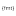

## RCommon

<h3 align="center">
    <br/>
    
    Radar common utility library
    <br/>
    <br/>
    
</h3>

#### Dependencies

- [**fmt**](https://github.com/fmtlib/fmt) - modern formatting library (**MIT**)
- [**spdlog**](https://github.com/gabime/spdlog) - fast C++ logging library (**MIT**)
- [**nlohmann/json**](https://github.com/nlohmann/json) - JSON adapters exposed by the opt-in
  `radar::mms::common::json` target (**MIT**)
- [**Qt 6**](https://www.qt.io/) - optional Core, Gui, Network, and Positioning integration enabled
  with
  `with_qt=True` in Conan or `RCOMMON_WITH_QT=ON` in CMake (**LGPL/GPL/commercial**)
- [**catch2**](https://github.com/catchorg/Catch2) - c++ testing
  framework (**BSL-1.0**)

#### CMake targets

- `radar::mms::common` provides the core library without a transitive nlohmann/json dependency.
- `radar::mms::common::json` adds the header-only JSON adapters and nlohmann/json dependency.
  With Qt enabled it also provides opt-in adapters for Qt Core, Gui, and Positioning types.

For an installed native CMake package, request the JSON dependency explicitly:

```cmake
find_package(RCommon REQUIRED COMPONENTS json)
target_link_libraries(my_target PRIVATE radar::mms::common::json)
```

#### Licensing

*RCommon* library is distributed under the MIT license. See [LICENSE](./LICENSE) for details.
